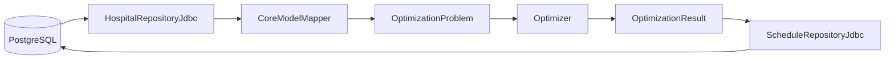

# Day 1 and Day 2 review — Ilyass

**Reviewed:** 2026-11-22  
**Scope:** Your PostgreSQL, persistence and shared-core integration work: `J1-IL` and `J2-IL`.  
**Branch:** `feat/database`  
**Committed base:** `b211c3b` — the review also includes the current uncommitted changes.

The requirements come from `Hospital_Scheduler_Plan_Complet.md` in the Obsidian
vault, under `Life/Academic/Projects/Java End to End Project/`.

## 1. Current position

The main Day 1 and Day 2 implementation tasks are present. PostgreSQL setup,
numbered migrations, hospital CRUD, candidate schedule persistence, overlap
protection and conversion to Aymane's shared classes are implemented.

Your latest Docker run passed **46 tests: 18 core tests and 28 integration tests**,
with no failures, errors or skips. The generated XML reports were inspected
before cleanup. This report was prepared by reviewing the code and recorded
results; it did not run another test suite.

Peer review, the other PCs' verification and the final commit/PR handoff remain
open. These results cover your persistence work; the other team members' complete
Day 1/Day 2 deliveries have not been certified by this review.

## 2. Day 1: requirements and implementation

| Planned task | What exists | Review status |
|---|---|---|
| Install/check PostgreSQL and Docker; provide Compose and connection examples without secrets. | PostgreSQL Compose service, health check, persistent volume, `.env.example`, connection instructions and helper scripts. Docker/Testcontainers works from your terminal. | Implemented; local Compose/IDE connection evidence is still unrecorded. |
| Draw the hospital entities and relationships. | Mermaid ER diagram, table explanations and Java mapping notes in the schema guide. | Implemented; Amine's schema review is pending. |
| Create the initial numbered migration with foreign keys, duration rules and `btree_gist`; anticipate later schedules/experiments. | V001 creates the foundation with 19 tables. Later schedule changes are separate migrations. Experiment functionality remains later work. | Implemented and exercised by the migration tests. |
| Write `MigrationIT` and document database setup for four PCs. | Six migration tests and a guide for Aymane, Amine, Ilyass and Youness. | Your Docker run passed; the other three PCs have no recorded pass. |

### Database setup

[compose.yaml](../scheduler-persistence/compose.yaml) defines:

- PostgreSQL `18.7-bookworm`.
- Default database/user: `project15_dev` / `project15`.
- Local host binding: `127.0.0.1:55432`, configurable through `.env`.
- A named volume that survives normal container shutdown.
- A health check and read-only mounts for scripts and migrations.

The tracked [.env.example](../scheduler-persistence/.env.example) contains an
empty password field. The actual `.env` is ignored by Git. Each PC supplies its
own password. Migrations run explicitly; starting the container does not apply
them automatically.

The [migration runner](../scheduler-persistence/scripts/migrate-database.sh)
applies files in numeric order, records SHA-256 checksums, takes an advisory lock
and runs the migration sequence in one transaction. Applied files must retain
their contents; subsequent changes use a new version.

The plan's illustrative V001 filename differs from the descriptive filename in
the repository. Its implemented purpose matches the Day 1 task; renaming an
already applied migration would break the recorded filename/checksum contract.

## 3. Migration inventory

All migrations are in
[`scheduler-persistence/src/main/resources/db/migration/`](../scheduler-persistence/src/main/resources/db/migration/).

| Version | File | Purpose |
|---|---|---|
| V001 | [V001__hospital_and_availability.sql](../scheduler-persistence/src/main/resources/db/migration/V001__hospital_and_availability.sql) | Hospital, departments, specialties, doctors, rooms, equipment, patients, requests, availability, absences, breaks and preferences. Includes joins, foreign keys, duration/bounds checks and `btree_gist`. |
| V002 | [V002__schedules.sql](../scheduler-persistence/src/main/resources/db/migration/V002__schedules.sql) | Algorithm metadata, hospital weeks, saved schedule versions, candidate assignments and confirmed appointments. |
| V003 | [V003__confirmed_appointment_exclusions.sql](../scheduler-persistence/src/main/resources/db/migration/V003__confirmed_appointment_exclusions.sql) | Global doctor/room overlap exclusions on confirmed appointments. |
| V004 | [V004__core_fitness_contract.sql](../scheduler-persistence/src/main/resources/db/migration/V004__core_fitness_contract.sql) | Shared fitness components, optimizer status, ordered score history and saved time zone. Preserves legacy scalar scores. |

There are **25 tables in the `hospital` schema** after V004: 19 from V001, five
from V002 and one from V004. V003 adds constraints rather than tables. The public
migration journal is separate.

V004 was added to preserve Aymane's actual fitness/result contract. It avoids
editing V001–V003 or guessing the components of existing scalar scores.

## 4. Day 2: requirements and implementation

| Planned task | What exists | Review status |
|---|---|---|
| Complete business/availability migrations and V002, separating candidate and confirmed data. | V001/V002 provide the data structure; V003 adds reservation protection; V004 aligns result storage with the shared core. | Implemented; fresh migration and upgrade checks passed. |
| Write `HospitalRepositoryJdbc`, load a week and save editing entities transactionally. | Weekly loading, atomic upserts, scoped window updates, shared-core problem loading and explicit full-record deletion. | Implemented; maintained repository tests passed, with additional temporary deletion checks. |
| Add doctor/room GiST exclusions; prepare `ScheduleRepositoryJdbc` and candidate batches. | Two global exclusions plus immutable candidate versions, batch assignment inserts, metadata/history persistence and schedule/result reload. | Implemented; overlap, concurrency, batch and rollback checks passed. |
| Run Testcontainers CRUD/time/FK/overlap/rollback tests and deliver DB fixtures. | Four maintained integration suites; their setup/fixture methods create isolated data. Your full Docker run passed. Additional temporary checks were removed after validation. | Execution verified; review and final evidence/fixture handoff remain to be agreed. |

### Hospital data: `HospitalRepositoryJdbc`

[Implementation](../scheduler-persistence/src/main/java/com/hospitalscheduler/persistence/HospitalRepositoryJdbc.java)
· [Contract](../scheduler-core/src/main/java/com/hospitalscheduler/repository/HospitalRepository.java)

| Operation | Behavior |
|---|---|
| `loadWeek(hospitalCode, monday)` | Returns editing data with the hospital's resources and requests relevant to the week. Reads share one repeatable-read snapshot. |
| `loadProblem(hospitalCode, monday)` | Returns Aymane's `OptimizationProblem` through the mapper. Only OPEN requests enter optimization. |
| `saveWeek(week)` | Creates or updates listed entities and their relationships in one transaction. A failure rolls everything back. |
| Explicit `delete…` methods | Remove a complete entity and its owned details transactionally, subject to foreign-key protection. |

Editing data retains multiple specialties, quantities, room types, recurring
preferences and other fields absent from the current optimizer model.

Weekly windows use local Monday boundaries converted through the hospital zone.
Editing reads preserve complete endpoints of windows crossing a boundary. Saving
a week preserves windows in other weeks. Omitted top-level records are retained;
deletion requires an explicit call.

Doctor, room, request, specialty and department deletion require both hospital
code and entity code. Hospital deletion uses its own code. Patient, equipment and
room-type deletion use global codes because those entities are shared in V001.

A saved assignment prevents deleting its doctor, room or request. Any remaining
request prevents deleting its patient. If an external reference blocks deletion,
`HospitalEntityInUseException` explains the problem and all owned-detail removals
are rolled back. A missing or out-of-scope record returns `false`.

### Schedules: `ScheduleRepositoryJdbc`

[Implementation](../scheduler-persistence/src/main/java/com/hospitalscheduler/persistence/ScheduleRepositoryJdbc.java)
· [Contract](../scheduler-core/src/main/java/com/hospitalscheduler/repository/ScheduleRepository.java)

- Saves a new candidate version under a unique code; duplicate codes cannot
  overwrite previous versions.
- Saves request/doctor/room IDs, absolute start/end instants and lock flags with
  a prepared JDBC batch. A 150-assignment batch was tested.
- Checks that referenced requests, doctors and rooms belong to the same hospital.
- Retains algorithm name/version, JSON parameters, seed and creation metadata.
- Saves both `FitnessBreakdown` components, every history entry in order and the
  exact `OptimizationResult.status`.
- Loads versions by code or hospital/week; restores shared `Schedule` and
  `OptimizationResult` objects using the matching supplied problem.
- Keeps metadata, assignments and history in one save transaction.

The two score components are `hardViolations` and `softCost`. They remain
separate, preserving the core's rule that hard violations take priority.
Optimizer status is distinct from the saved schedule's lifecycle status.

Old scalar scores remain available as `legacyFitness`. The repository refuses
to manufacture an `OptimizationResult` when its original components/status are
unknown. Their appointment assignments can still be loaded independently.

### Candidate and confirmed behavior

| Case | Database behavior |
|---|---|
| Two candidates overlap. | Allowed for fitness evaluation and optimization. |
| Two confirmed appointments overlap for one doctor. | Rejected, including across schedule versions. |
| Two confirmed appointments overlap for one room. | Rejected, including when their doctors differ. |
| One appointment ends exactly when the next starts. | Allowed through `[start,end)` interval semantics. |
| Another transaction has a conflicting uncommitted reservation. | The competing confirmation waits, then fails after commit or can succeed after rollback. |

The exclusion keys contain resource ID and time range, without schedule ID.
This makes them protect actual resource reservations across all saved versions.

## 5. Integration with Aymane's shared classes

The integration reference was Aymane's implemented classes and
[shared API contract](contracts.md). A standalone UML class diagram was not found
in the remote branches checked during the earlier repository review.



[CoreModelMapper](../scheduler-persistence/src/main/java/com/hospitalscheduler/persistence/CoreModelMapper.java)
provides the conversion. The existing `Patient`, `Doctor`, `Room`,
`AppointmentRequest`, `TimeSlot`, `Appointment`, `Schedule`, `FitnessBreakdown`
and optimizer interfaces are used by the application-facing path.

| Mapping | Current rule / limit |
|---|---|
| Specialty strings | Stable specialty codes are used on both doctors and requests. A doctor needs one qualification or an explicit selection from their stored qualifications. |
| Urgency | Configurable default: ROUTINE=1, PRIORITY=2, URGENT=3. This convention still needs team review. |
| Doctor unavailability | Absences and breaks combine into the core's unavailable periods. |
| Equipment | Available quantities become equipment presence. Required quantities above one are rejected because the core has a set rather than quantities. |
| Patient preferences | Preserved for editing; optimization rejects them while the shared core has no representation. |
| Room types | A required type is accepted when the supplied rooms already satisfy it; mixed incompatible types require a core extension or a different agreed projection. |
| Time | SQL instants convert through the hospital zone. Missing/repeated local clock times are rejected because `TimeSlot` cannot retain an offset. |
| Saved zone | A schedule captures its conversion zone, so a later hospital-zone change does not reinterpret its appointments. |

These checks make unsupported requirements visible. They do not establish that
the richer database features are implemented in the optimizer or fitness engine.

## 6. Verification and cleanup

The latest user-run command was:

```bash
bash mvnw -pl scheduler-persistence -am -Ppersistence-it verify
```

The inspected XML reports recorded:

| Suite | Tests | Main coverage |
|---|---:|---|
| Core unit tests | 18 | Domain behavior, completeness, fitness ordering and optimizer contracts. |
| `MigrationIT` | 6 | Fresh database, V001 upgrade, replay, basic FK/duration rules, candidate structure and metadata validation. |
| `HospitalRepositoryJdbcIT` | 7 | Editing round trips, updates, rollback, window references, hospital scoping, week boundaries and clock-change weeks. |
| `ScheduleRepositoryJdbcIT` | 8 | 150-assignment batch, metadata/locks/time, versions, JSON validation, batch rollback, immutable codes and hospital scoping. |
| `ConfirmationConstraintsIT` | 7 | Doctor/room conflicts, adjacency, updates, legacy conflicts and concurrent commit/rollback. |
| **Total** | **46** | **Zero failures, errors or skips.** |

All four integration suites used Docker/Testcontainers: no native JDBC override
was present. Maven's Java runtime was `17.0.19`. A full six-module build also
passed during the shared-core integration work.

Additional temporary checks verified the shared optimizer/result round trip,
legacy-score upgrade, mapping guards, saved zones and full-record deletion,
including rollback and concurrent deletion. Their sources, standalone fixtures,
scripts, temporary databases and generated outputs were removed as requested.

**Coverage limit:** the maintained 28-test integration suite does not include the
removed temporary mapper/result/deletion checks. Their recorded success is useful
review evidence; rerunning the maintained suite alone does not repeat those cases.
The retained tests contain their own fixture/setup data. A separately published
fixture package or demo seed has not been delivered.

Raw XML reports and generated `target/` outputs were deleted after inspection.
The recorded summary is in
[the verification note](../scheduler-persistence/docs/proofs/J1-IL.md).
Test-first/red-phase evidence has not been recorded; a passing run alone does not
prove the plan's TDD process was followed.

## 7. Remaining review and handoff checklist

- [ ] **Amine reviews Day 1's schema**, as assigned by the plan.
- [ ] **Aymane reviews Day 2's repositories and shared-core integration.**
- [ ] Agree on urgency integers, specialty selection and the supported time/grid
  conventions with the team. The default mapping and current limitations are documented.
- [ ] Record the local Compose database/IDE connection check; successful
  Testcontainers execution uses a separate disposable database.
- [ ] Record setup/build/test results for the other three PCs on the same revision.
- [ ] Agree that the maintained tests' fixture data meets the Day 2 fixture
  handoff requirement, or provide the additional fixture format the team needs.
- [ ] Align the evidence handoff with the plan's requested per-day
  `docs/proofs/Jx-NOM.md` notes. The current module-level J1 note and this report
  consolidate results; a dedicated J2 proof note has not been created.
- [ ] Review and commit all intended files, including currently untracked V004,
  `CoreModelMapper` and `HospitalEntityInUseException`; then push/open the PR.

Implementation is ready for this review. Formal acceptance is still pending the
checks above.

## 8. Boundaries to keep in mind

- The database rejects resource overlaps and broken references. Full business
  feasibility—specialties, availability, equipment, durations and completeness—
  still requires the application's validator/fitness implementation.
- A service that validates and atomically publishes/replaces confirmed bookings
  has not been implemented. The Day 2 candidate repository and DB constraints
  provide its foundation.
- The proposed 15-minute grid is not enforced by the current SQL duration rules.
- Locks are persisted; preserving them during optimization remains a core/service
  responsibility.
- `loadResult` needs a matching problem containing the referenced IDs. The
  repository does not recreate a historical hospital-problem snapshot after edits.
- Writes are transactional and scoped. Stale editing snapshots have no optimistic
  version check and can overwrite newer values if the service permits it.
- Automatic application startup wiring, a production fitness engine, optimizer
  implementations, JavaFX workflows, experiments and CI delivery are separate work.

## 9. Files to read next

1. [Schema and ER diagram](../scheduler-persistence/docs/database-schema.md).
2. [Setup, repository usage and mapping rules](../scheduler-persistence/docs/database-setup.md).
3. [Database decisions](../scheduler-persistence/docs/decisions.md).
4. [Four-PC setup checklist](../scheduler-persistence/docs/team-setup.md).
5. [Recorded verification](../scheduler-persistence/docs/proofs/J1-IL.md).
6. [Shared core API contract](contracts.md).
