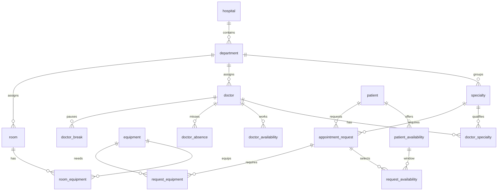

# PostgreSQL schema

The Day 1 schema is in `src/main/resources/db/migration/V001__hospital_and_availability.sql`.
It creates 19 tables in the `hospital` schema for the hospital, departments,
specialties, doctors, rooms, equipment, patients, requests and their availability.
The migration also installs `btree_gist`, uses foreign keys, and checks positive
finite durations and half-open time ranges.

`doctor_specialty`, `room_equipment`, `request_availability` and
`request_equipment` are join tables. Composite foreign keys ensure a request
uses its own patient's availability window. Appointment duration is constrained
to 1–1440 minutes. The team's proposed 15-minute grid remains an application
contract to confirm.

## Mapping to the current core

| Core type | Initial database representation | Open mapping detail |
|---|---|---|
| `Patient` | `patient` | Java `long` maps to SQL `bigint`. |
| `Doctor` | `doctor`, `doctor_specialty`, dated availability/absence/break rows | Core has one specialty string; SQL supports multiple specialties. |
| `Room` | `room`, `room_equipment`, `equipment` | Type and quantity are preserved in the repository DTOs. |
| `TimeSlot` | `timestamptz` endpoints, `[start,end)` range | Convert instants through the hospital zone to Java `LocalDateTime`. |
| `AppointmentRequest` | `appointment_request`, patient windows and equipment links | Java urgency is an unstandardized integer; SQL uses named levels. |

## Day 2 task 1: schedules

`V002__schedules.sql` adds five tables, bringing the total to 24:

| Table | Purpose |
|---|---|
| `algorithm` | Method name, stable code and version. |
| `schedule_week` | Hospital and local Monday date; one row per hospital/week. |
| `schedule` | Saved version with method, JSON parameters, seed, fitness and lifecycle status. |
| `candidate_assignment` | One proposed assignment per request per schedule, with doctor, room, interval and lock flag. |
| `confirmed_appointment` | Operational reservation referring to the exact saved assignment. |

A week can have several saved schedules. Candidate assignments use finite,
positive, half-open `[start,end)` intervals and valid foreign keys, but overlapping
resources are allowed. `locked` can also be stored on a candidate; preserving
locks during optimization is an application responsibility.

Confirmed reservations repeat the assignment's request, doctor, room and instants
for the resource exclusions added by V003. A composite foreign key
requires those values to match the saved assignment and prevents changing it
while reserved. A request can have only one active confirmed reservation.
Deleting a reservation preserves its candidate assignment and schedule history.

Statuses are `DRAFT`, `RUNNING`, `CANDIDATE`, `CONFIRMED` and `ARCHIVED`.
Candidate and confirmed schedules require a finite nonnegative fitness; parameters
must be a JSON object. Status transitions, completeness, request duration matching,
availability, specialty, equipment and week boundaries need application validation.
Confirmation must eventually update reservations and schedule status atomically.

V003 adds global doctor/room overlap exclusions. Confirmation transactions
remain subsequent work. Seed data and experiment
tables remain later work.
See [setup](database-setup.md), [team decisions](decisions.md), and the
[core contract](../../docs/contracts.md).

## Day 2 task 2: hospital repository

`HospitalRepository` and its immutable `HospitalWeek` data contract live in core;
`HospitalRepositoryJdbc` implements them in persistence with an injected
`javax.sql.DataSource`. No JDBC types or PostgreSQL dependencies enter core.
The repository preserves multiple specialties, equipment quantities, room types,
request status/urgency, dated windows, absences, breaks and recurring preferences.

Weekly reads use the hospital's IANA zone to compute the two local Monday
boundaries, then compare absolute instants in PostgreSQL. Intersecting windows
retain their original endpoints, including windows crossing a week boundary.
All SELECTs share a repeatable-read transaction and deterministic ordering;
related collections are loaded in groups instead of one SELECT per doctor.

The current optimizer model still needs a separately agreed mapping for urgency,
multiple specialties, quantities and local date-times. The editing DTO avoids
silently dropping those fields while that contract is finalized.

## Day 2 task 3: confirmed resource exclusions

`V003__confirmed_appointment_exclusions.sql` adds two GiST exclusion constraints
to `confirmed_appointment`:

| Constraint | Rejects |
|---|---|
| `confirmed_doctor_no_overlap` | Equal doctor IDs with overlapping `occupied_at` ranges. |
| `confirmed_room_no_overlap` | Equal room IDs with overlapping `occupied_at` ranges. |

The exclusion keys deliberately omit the schedule ID: operational reservations
must not overlap across versions. Half-open `[start,end)` ranges allow adjacent
appointments. Candidates retain their existing behavior and may overlap.
The exclusions apply to INSERT and UPDATE, including concurrent transactions.
PostgreSQL returns SQLSTATE `23P01` and the violated constraint name. A conflicting
uncommitted reservation makes a competing insert wait; after its commit the
competitor fails, or after its rollback the competitor can succeed.

V003 validates existing reservations. If existing confirmed rows overlap, the
migration fails atomically and keeps their data; resolve those conflicts before
retrying. It never deletes or moves bookings automatically. Business validation,
atomic replacement of a week's reservations, schedule status updates and stale
version handling still belong in the future confirmation service/repository.

## Day 2 task 3: schedule repository

`ScheduleRepository` and `ScheduleSnapshot` live in core. The JDBC implementation
in persistence uses the existing V002 tables without changing any migration.
`saveCandidate` creates a new saved version, reuses or creates its hospital week
and algorithm, then inserts all assignments with a prepared JDBC batch. Any
failed statement or invalid reference rolls the entire operation back.

Each saved version has a unique code; existing versions are never overwritten.
A request occurs at most once in a version. Every assignment's request, doctor
and room must belong to the version's hospital, but resource overlaps and other
fitness violations remain representable. This method never writes operational
reservations or sets a schedule to CONFIRMED.

Loads use repeatable-read transactions. Week loads fetch assignments and metadata
in two grouped queries; versions are ordered by creation timestamp/ID and their
assignments by request ID. Algorithm metadata, canonical JSON parameters, seed,
exact fitness, timestamps and lock flags survive reload. Assignment database IDs
remain internal; the public contract identifies an assignment by its request
within the saved version.
