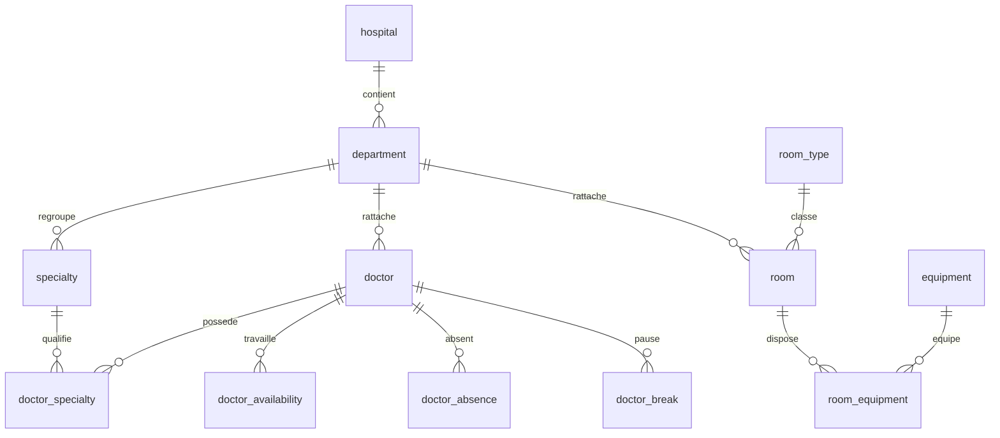
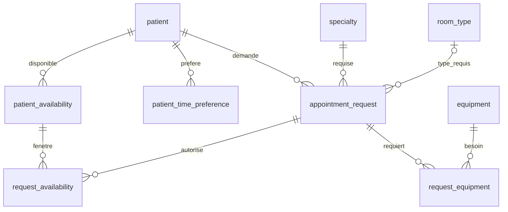
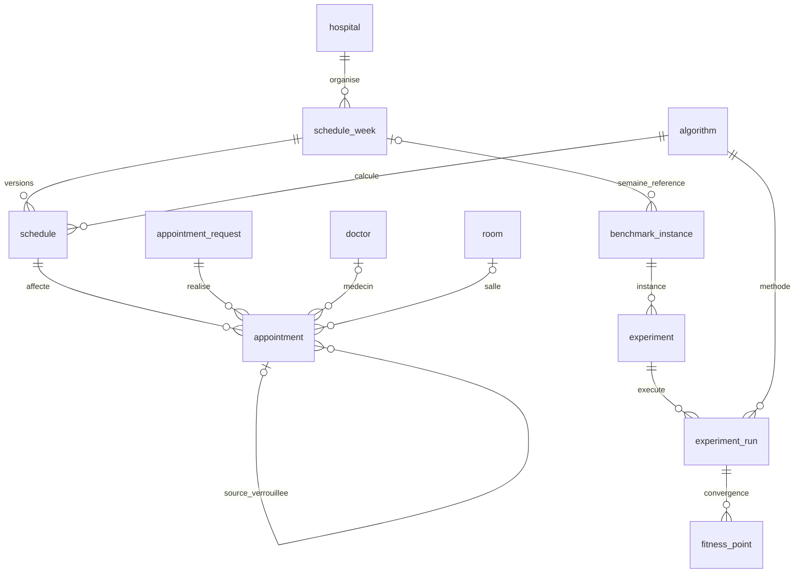

# Schéma PostgreSQL et contrat de persistance

Ces diagrammes décrivent les migrations intégrées dans `scheduler-persistence`.
Le mapping ci-dessous a été confronté aux classes réelles de `scheduler-core`.
Le schéma applicatif est `hospital` ; il contient 27 tables. Le journal de
migration est séparé : `public.database_schema_migration`.

## Ressources hospitalières

`doctor_specialty` et `room_equipment` sont les associations N–N. La seconde
porte une quantité positive. Une spécialité appartient à un département ; le
contrôle de cohérence entre hôpitaux reste applicatif.

## Patients et demandes

Les FK composées de `request_availability` imposent que la fenêtre et la demande
appartiennent au même patient. Une préférence est souple ; une disponibilité est
obligatoire. `duration_minutes` est compris entre 1 et 1440 ; l’alignement sur une
grille de 15 minutes relève du futur contrat d’application.

## Plannings et expériences

Une affectation candidate peut être incomplète ; une confirmation exige médecin,
salle et bornes. La clé `(schedule_id, request_id)` interdit de doubler une demande
dans une même version. Les exclusions sur les confirmés portent sur toutes les
versions. `demo_dataset`, la 27e table, marque les fixtures ; les principales
entités peuvent lui être rattachées par `demo_dataset_key`, sans que des données
utilisateur soient obligées d’appartenir à la démonstration.

Les conventions ouvertes et les limites de l’historique figurent dans
[les décisions locales](decisions.md). La connexion et les conversions temporelles
sont décrites dans [le guide d’installation](database-setup.md).

## Relations et correspondance avec le core existant

| Relation | Cardinalité retenue |
|---|---|
| Hôpital → départements ; département → spécialités/médecins/salles | 1 → N ; appartenance obligatoire |
| Médecin ↔ spécialités | N ↔ N par `doctor_specialty` |
| Salle → type de salle ; salle ↔ équipements | N → 1 ; N ↔ N avec quantité par `room_equipment` |
| Médecin → disponibilités/absences/pauses | 1 → N intervalles datés |
| Patient → fenêtres/préférences/demandes | 1 → N |
| Demande ↔ fenêtres patient/équipements | N ↔ N par `request_availability` / `request_equipment` |
| Hôpital → semaines → plannings → rendez-vous | 1 → N à chaque étape |
| Demande → rendez-vous | 1 → N entre plannings, 0 ou 1 dans un planning |
| Algorithme → plannings/exécutions | 1 → N |
| Instance → expériences → exécutions → points de fitness | 1 → N à chaque étape |
| Rendez-vous candidat → réservation source | N → 0 ou 1, FK `carried_from_appointment_id` |

La FK composée de `request_availability` vérifie que la fenêtre appartient au
patient de la demande. Les identifiants sont tous des `bigint GENERATED ALWAYS
AS IDENTITY`, les codes métier des textes uniques. Les associations ne sont pas
supprimées en cascade : les suppressions doivent être explicites.

| Type réel dans `scheduler-core` | Tables SQL | Mapping et limite constatée |
|---|---|---|
| `Patient(long id, String name)` | `patient.id`, `display_name` | `bigint` correspond au `long` Java ; codes et e-mails restent des métadonnées SQL. |
| `Doctor(long id, String name, String specialty, List<TimeSlot> workingHours, List<TimeSlot> unavailableSlots)` | `doctor`, `doctor_specialty`, `doctor_availability`, `doctor_absence`, `doctor_break` | Combiner pauses et absences pour les indisponibilités. Le core accepte une seule spécialité ; la démo contient deux médecins multi-spécialités. Aucune spécialité arbitraire ne doit être choisie. |
| `Room(long id, String name, Set<String> equipment)` | `room`, `room_equipment`, `equipment` | Les codes stables sont des identités possibles pour les chaînes ; le type de salle et les quantités ne sont pas représentés dans le core. |
| `TimeSlot(LocalDateTime start, LocalDateTime end)` | Colonnes `starts_at`, `ends_at` en `timestamptz` | Lire `OffsetDateTime`, convertir via le `ZoneId` de l’hôpital puis `toLocalDateTime()`. Les deux modèles utilisent `[début, fin)`. Résoudre explicitement les heures ambiguës/inexistantes à l’écriture. |
| `AppointmentRequest` | `appointment_request`, `patient`, `specialty`, `request_availability`, `patient_availability`, `request_equipment` | Durée entière en minutes ; fenêtres propres à la demande via les associations patient. Urgence Java `int` sans ordre défini contre trois libellés SQL : convention à définir. Statut et type de salle ne sont pas dans le core. |
| `Appointment(request, doctor, room, timeSlot)` | `appointment` | Les quatre arguments Java sont obligatoires ; les candidats SQL incomplets ne peuvent pas être reconstruits sans un contrat supplémentaire. Verrou, statut et provenance restent des métadonnées SQL. |
| `Schedule(List<Appointment>)` | `schedule`, `schedule_week`, `appointment` | Unicité de l’ID de demande dans les deux modèles. ID de planning, semaine, publication et algorithme ne font pas partie du `Schedule` Java. |
| `OptimizationProblem` | Ressources et demandes sélectionnées | Contient trois listes : médecins, salles, demandes. La sélection par hôpital/semaine et les réservations externes nécessitent une API de persistance explicite. |
| `OptimizationParameters(long seed, int maxIterations)` | `random_seed`, `parameters` JSON | Graine signée 64 bits compatible ; `maxIterations` doit être conservé explicitement dans les paramètres. Le budget SQL en millisecondes n’est pas un nombre d’itérations. |
| `FitnessBreakdown(int hardViolations, double softCost)` | `schedule.final_fitness`, `experiment_run.final_fitness`, `hard_violations`, `fitness_point.fitness` | Le core minimise la paire lexicographiquement. Le score scalaire synthétique SQL ne suffit pas pour stocker/reconstruire cette paire ; une migration supplémentaire est requise avant persistance de vrais résultats. |
| `OptimizationResult`, `OptimizationProgress` | `schedule`, `experiment_run`, `fitness_point` | Le core a un historique de paires de fitness et un statut `String` sans vocabulaire standard. Les colonnes actuelles ne stockent pas encore toutes ces informations sans perte. |

`Hospital`, `Department`, `RoomType`, les statuts persistés, les préférences,
les expériences et les réservations verrouillées n’ont pas de types équivalents
actuels dans le core. Les tables servent déjà aux tests SQL, mais aucune couche
DAO métier n’est déclarée implémentée. Les écarts et décisions d’adaptation sont
suivis dans [decisions.md](decisions.md), en référence au
[contrat partagé réel](../../docs/contracts.md).

Le remplacement transactionnel transfère l’identité des réservations verrouillées
au nouveau planning ; l’ancien planning archivé n’est pas un instantané complet.
Si un historique immuable est requis, séparer la réservation réelle des
associations entre chaque version de planning et ses affectations.

## Garanties SQL et responsabilités applicatives

La base garantit les FK, codes uniques, associations sans doublon, durée de
demande positive, intervalles finis avec fin strictement après début, et un seul
rendez-vous par demande **par planning**, quel que soit son statut. Une ligne
annulée occupe encore cette clé : la réutiliser ou la supprimer explicitement
avant de recréer l’affectation. Une affectation candidate peut être entièrement
non datée et non affectée, mais ne peut avoir qu’une seule borne renseignée.
Une confirmation exige médecin, salle et deux bornes non nulles. `locked=true`
exige `CONFIRMED`. Un seul planning peut être `PUBLISHED` par semaine/hôpital.

Deux exclusions GiST partielles, `confirmed_doctor_no_overlap` et
`confirmed_room_no_overlap`, utilisent l’égalité de la ressource et `&&` sur
`occupied_at`, avec `WHERE (status = 'CONFIRMED')`. **Le planning ne figure pas
dans leurs clés** : les réservations réelles sont protégées globalement. Elles
s’appliquent aux `INSERT` et aux `UPDATE` de statut, ressource ou bornes, y compris
entre transactions concurrentes. Les candidats peuvent chevaucher des confirmés
ou d’autres candidats. SQLSTATE attendu pour une exclusion : `23P01` ; vérifier
aussi le nom de contrainte.

Le calcul de fitness doit contrôler spécialité, hôpital, type/équipement et
quantités, durée, disponibilités patient/médecin, pauses, absences, semaine,
chronologie, patients simultanés et respect des verrous. Il pénalise aussi les
affectations manquantes et les conflits **internes au candidat**. Une copie
candidate d’une réservation verrouillée référencée ne constitue pas une deuxième
occupation réelle ; tenir compte des réservations externes qui ne seront pas
libérées lors de la publication. Ne pas additionner tous les candidats comme
s’ils étaient réservés simultanément. Les préférences sont souples, leur
pondération appartient à l’objectif Java. Le schéma accepte volontairement les
candidats infaisables pour que l’interface puisse afficher leurs violations.

Avant confirmation, l’application refait ces contrôles dans une transaction avec
les verrous appropriés. Modifier une absence n’annule pas automatiquement un
rendez-vous ; une FK n’interdit pas de déplacer un rendez-vous marqué verrouillé.
Ces règles métier, les transitions d’état, la validité d’un nom de fuseau et
l’intégrité d’une courbe complète restent applicatives. Une exécution terminée
exige ses résultats non nuls ; le dernier point égal au résultat final, les temps
ordonnés et la cohérence des violations sont vérifiés sur le jeu de démonstration.
Tous les scores doivent être finis et non négatifs ; un objectif Java maximisé
ou négatif nécessiterait une migration d’adaptation.

## Publication et remplacement atomiques

`DRAFT` et `RUNNING` peuvent conserver une fitness `NULL`. `CANDIDATE` et
`PUBLISHED` exigent un résultat final. La publication d’un planning et le statut
des rendez-vous sont distincts : SQL n’impose pas que toutes ses lignes soient
confirmées. L’application effectue l’ensemble des transitions dans **une même
transaction**. Une réservation restée `CONFIRMED` continue d’occuper sa ressource,
même si son planning est archivé.

Le scénario exécutable [replanning.sql](../db/verify/replanning.sql), terminé par
`ROLLBACK`, démontre le remplacement suivant :

1. Verrouiller la semaine (`FOR UPDATE`), les deux plannings et leurs rendez-vous.
   Faire participer les éditions de disponibilités/absences au même protocole
   de verrouillage ; sinon employer une stratégie sérialisable avec reprises.
2. Calculer et valider l’alternative, en conservant toutes les réservations
   verrouillées. Archiver l’ancien planning, puis annuler ses réservations
   déverrouillées pour libérer leurs créneaux.
3. Supprimer les copies candidates qui référencent les réservations verrouillées,
   puis transférer les **lignes originales**, avec leurs mêmes identifiants,
   au nouveau planning. Leur statut reste `CONFIRMED`, leurs ressources et heures
   restent identiques ; aucune seconde réservation confirmée n’est créée.
4. Appliquer la nouvelle affectation, confirmer les autres candidats, recalculer
   le résultat, puis publier le nouveau planning. Valider la couverture et la
   faisabilité avant `COMMIT`. En cas d’erreur, annuler toute la transaction.

Le test crée une absence fictive du médecin `demo15.doc.1`, lundi 16 novembre
10:00–10:30. Seule `demo15.req.011`, 10:00–10:15, est affectée. Le médecin
`demo15.doc.2`, de même spécialité et disponible, la reprend dans la même salle
et aux mêmes heures. Les 150 réservations subsistent, les cinq verrous gardent
leurs identifiants et un seul planning reste publié. Le `ROLLBACK` remet la base
dans son état initial.

